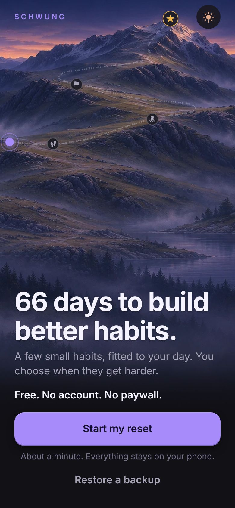
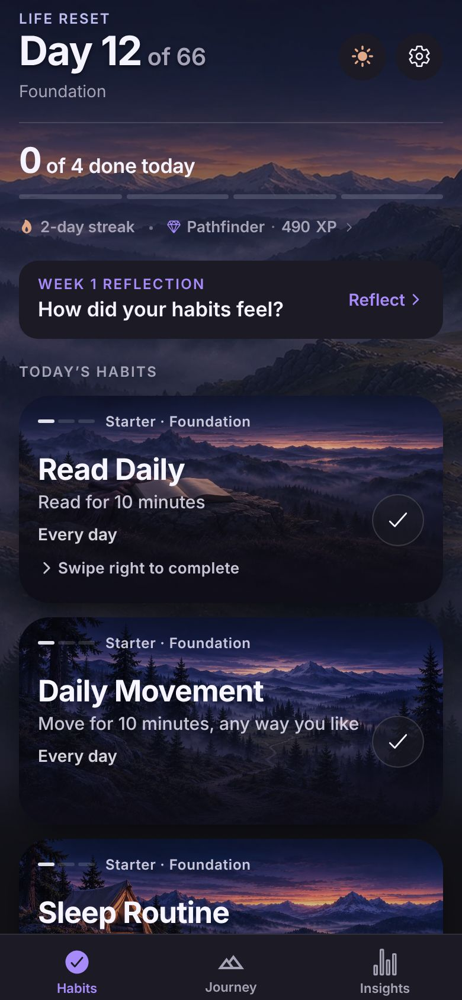
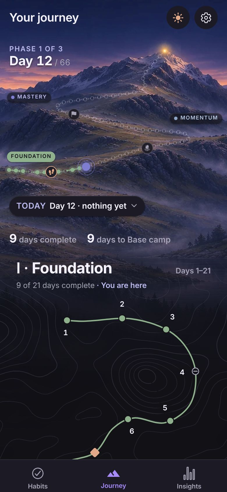
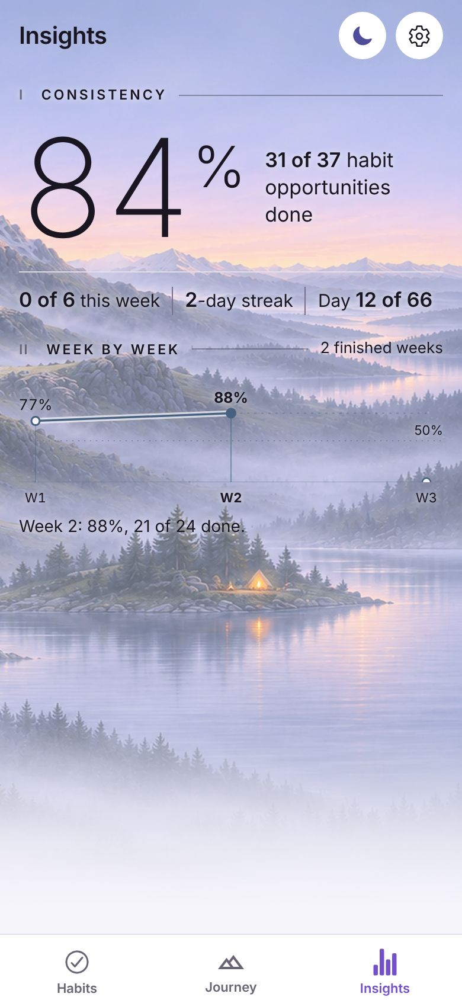

# Schwung

**Get your momentum back.** Schwung (German for "momentum") is a calm iPhone app for one thing: a **66-day Life
Reset**. Pick a few small habits, start each at a level that fits your day, and climb a painted mountain one day at a
time. Free, with no account, no ads, no paywall and no tracking.

<p align="center">
  
  
  
  
</p>

<sub>Screenshots from the app's web build with a sample program on Day 12.</sub>

## The 66-day journey

- **Set up in about a minute.** Choose from eleven habits (Read Daily, Daily Movement, Sleep Routine, Meditation,
  Get It Done, Less Scrolling, Time Outdoors, Eat Well, Practice a Skill, Stay Connected, Strength Training) or
  write your own. Set-up asks only what those habits need, then suggests a starting level for each: Starter,
  Standard or Challenge.
- **Swipe a card to mark it done.** Weekly habits count by the week, rest days are never "missed", and a missed day
  is never a broken promise: the app helps you come back.
- **Three phases:** Foundation (Days 1–21), Momentum (22–44) and Mastery (45–66). Habits step up only when you're
  ready, and you can always choose easier.
- **Journey** draws the 66 days as a trail up the mountain, with milestones, weekly reflections and keepsakes earned
  along the way. **Insights** shows consistency, weekly trends and each habit's history, from your own days only.
- **At the summit** there's a 66-day story to keep, then a choice: keep your momentum, begin a new ascent, or decide later.
- 20 languages (including Arabic and Urdu, right to left), light and dark themes, built for VoiceOver and larger text.

## Private by design

Everything stays on your phone. There's no account, no server, no analytics and no ads; the app works fully offline.
Your data leaves the phone only when you choose to: a backup file you share, an email you write, or a voluntary
tip.

The optional **Support** screen offers three one-off tips, and a few more fixed amounts under "Choose another amount",
through Apple's In-App Purchase, processed by
[RevenueCat](https://www.revenuecat.com). A tip unlocks nothing. RevenueCat is started only when that screen is
opened (or to finish a tip that was interrupted), anonymously, without device identifiers. Details:
[`docs/legal/PRIVACY_POLICY.md`](docs/legal/PRIVACY_POLICY.md).

Schwung is a wellness app, not medical advice; set-up asks about health only to keep habits safe, and the answer
never leaves the phone.

## Development

Built with Expo SDK 58 (React Native 0.88), Expo Router, TypeScript, Zustand, Reanimated 4 and react-native-svg.

```bash
npm install
npx expo start --clear        # Expo Go or a development build; iOS is the target
```

| Check | Command |
| --- | --- |
| Unit and regression tests | `npm test` |
| Types, lint | `npm run typecheck`, `npm run lint` |
| Translations | `npm run i18n:check` |
| 66-day simulations | `AUDIT=1 npx jest scripts/audit` |
| Visual QA (20 languages, sizes, themes) | `npm run qa:build && npm run qa:fixtures && npm run qa` |
| Release readiness | `npm run release:check` |

- **Build channels:** `EXPO_PUBLIC_SCHWUNG_CHANNEL` is `development` (default; developer clock on Habits),
  `internal` (testers, `eas build --profile internal`, its own app identifier) or `production`
  (`eas build --profile production`). Use `--clear` when switching.
- **Release identity** (app name, bundle ID, support email, URLs, tip product IDs, RevenueCat's public SDK key) lives
  only in [`release.config.json`](release.config.json). `npm run release:check` refuses an App Store build while
  anything there is a placeholder.
- **Tips** need a development or App Store build: RevenueCat is a native module that Expo Go doesn't include, so
  there the Support screen shows the tips as unavailable. App Store builds hide Support until `release.config.json`
  has the real product IDs and RevenueCat key.

More: [`AGENTS.md`](AGENTS.md) (architecture and rules) and [`docs/`](docs/README.md).

## Licence

Copyright © the Schwung publisher. All rights reserved. No open-source licence is granted for this code or its
artwork. The open-source components it's built on keep their own licences:
[`THIRD_PARTY_NOTICES.md`](THIRD_PARTY_NOTICES.md).
