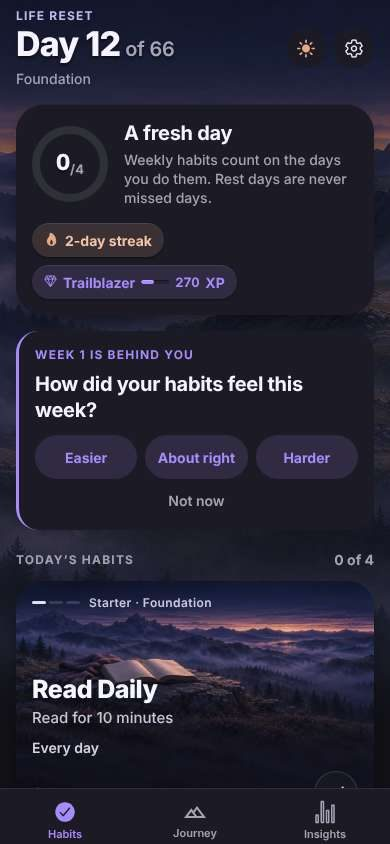
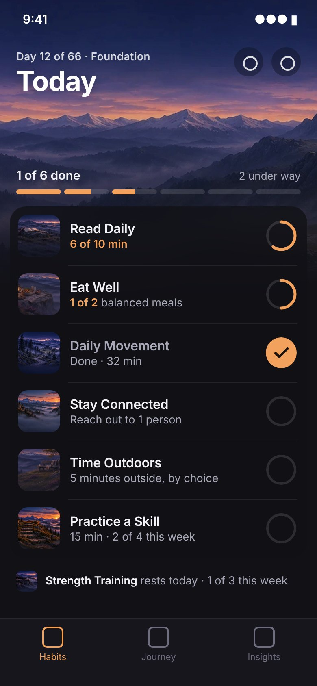
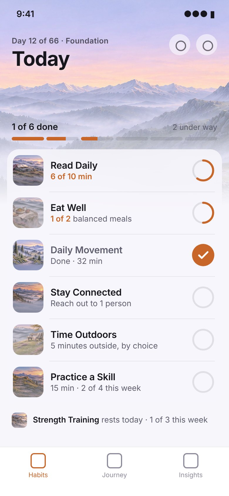

# Habits redesign: Phase 1 (design only)

Direction: **"A trail log under the mountain."** The mountain is visible at the top of the screen. Below it, today's habits sit
in one calm list that you can scan and tick off without scrolling. This answers `DESIGN_CRITIQUE.md` sections 1, 2,
3, 4 and 7. Nothing in the app has changed yet.

| Before (dark) | Proposed (dark) | Proposed (light) |
| --- | --- | --- |
|  |  |  |

States and interactions: [dark](habits-redesign/states-dark.jpg) · [light](habits-redesign/states-light.jpg).
The mockups are HTML built from the shipped artwork (`habits-redesign/mockup.html`) and rendered with Playwright.

## Screen composition (top to bottom)

1. **Mountain band (~250 pt).** The Habits view of the world painting, at full strength with no haze over it. It
   fades into the background just above the list. Over it sit a small kicker ("Day 12 of 66 · Foundation"), the
   title "Today", and the theme and settings buttons.
2. **One progress indicator.** "1 of 6 done" plus a segmented bar with one segment per habit due today. A segment
   fills partway when its habit has partial progress. The streak, rank, XP and the 0/4 ring leave this screen.
3. **The list.** One translucent surface, 72 pt rows, hairline dividers, no shadows and no pills. On a 390 × 844
   phone, six habits fit above the tab bar (the target was 3–4).
4. **Resting line.** One quiet line under the list, for example "Strength Training rests today · 1 of 3 this week",
   with a small thumbnail. It is shown in full colour, not greyed out, and only appears when something is resting.

## Compact row

- **Thumbnail.** 52 pt, radius 12, a crop of the habit's own painted scene (subject in the upper 40%). Custom
  habits use the existing world-crop placeholder. This keeps the art without putting a painting behind every row.
- **Name** in 16 pt semibold. **Target line** in 13.5 pt: the target, or progress once there is some.
- **Completion ring** on the right, 40 pt, with a 44 pt tap area. It is the only control on the row.
- **Accent** is a single sunrise orange taken from the paintings: #F2A25C in dark mode, #C8662A in light mode. It
  marks progress and completion only. No success green, no violet.

## The three states

| State | Ring | Target line | Row |
| --- | --- | --- | --- |
| Not started | Empty track | The target ("Reach out to 1 person") | Normal |
| Partly done | Orange arc, proportional | Orange progress ("6 of 10 min", "1 of 2 balanced meals") | Normal |
| Completed | Filled orange with a check | "Done · 32 min" | Name in secondary ink. The row stays in place. |

**Weekly habits** (Practice a Skill, Stay Connected at fewer than 7 days, Get It Done on workdays, Strength
Training) also show small week pips under the target line, for example ●●○○ for 2 of 4. The ring always means
*today*, and the pips mean *this week*.

## Interaction

- **Swipe right** completes the habit in full, as now. It leaves a short undo snackbar. "Swipe to complete" is
  shown once, the first time, and never again.
- **Tap the ring** logs part of the target, depending on the habit's completion kind:
  - **Counter** (Eat Well, Stay Connected, Get It Done): each tap adds 1. Reaching the target completes the habit.
  - **Timer** (Read, Meditation, Movement, Practice a Skill): opens a small popover with "+5 / +10 / +15" and
    "Start timer". Reaching the target completes the habit.
  - **Check** (Sleep Routine, Time Outdoors, Less Scrolling): a tap completes it, the same as swiping. There is
    no partial state.
  - **Session** (Strength Training): a tap completes today's session.
- **Tap the row** (anywhere except the ring) opens the habit's details, where its scene is shown large. This
  replaces long-press, which nobody finds.
- **Undo** on a completed habit: swipe left, or tap the filled ring for "Undo · Edit amount".

## Removed from the Habits screen

- The ~150 pt painted cards, and the scene behind each row.
- The level line ("Starter · Foundation"), "Every day" and "Swipe right to complete" on every card.
- The footer hint.
- The summary card: the 0/4 ring, "A fresh day" with its paragraph, the streak pill, and the rank and XP pill
  with its bar. These move to Journey or the Collection.
- The weekly reflection card at the top of the list. It moves to Journey, or becomes a one-line prompt that
  appears only on the review day.
- The grey wash on resting habits.
- The lavender haze over the background art.

## Decisions needed before implementation

1. **Partial progress and the rules.** Does partial progress count toward anything (day completion, XP, streak),
   or is it display-only for now? This proposal assumes display-only. No rules change.
2. **Check habits.** Confirm they have no partial state, or say whether a "did some" option is wanted.
3. **Over-target.** If someone logs 25 of 10 minutes, is it shown as "Done · 25 min" (proposed) or capped?
4. **Timer reaching the target.** Should it complete the habit automatically, or wait for a confirm?
5. **Row order.** Should completed rows stay in place (proposed, nothing jumps) or sink to the bottom?
6. **Weekly habits once the week's target is met.** Do they move to the resting line (proposed) or stay listed?
7. **Where the streak, rank and XP go.** Journey header, Collection only, or dropped from daily view.
8. **Weekly reflection.** Should it move to Journey or become a one-line prompt on the day?
9. **Accent colour.** Sunrise orange replaces violet on this screen. Should the rest of the app follow (critique
   section 7)?
10. **Persisting partial progress.** Partial amounts need storing per habit per day. The data model change and the
    save migration need sign-off before any code is written.
