# Minimum Effort: content and visual approval package

**Status:** approved by the owner (`d7652fc`): the six minimums, the shared wording, the placements and mark A.
Built in R2b (`docs/MINIMUM_EFFORT_R2B.md`). What follows is the package as it was approved.

- The engine (R2a, `8948322`) is approved and stays unreachable.
- The screens (R2b) wait for this package.
- The rules come from `docs/MINIMUM_EFFORT_SPEC.md`.

**How the mockups were made.** They're the real app, not drawings:

1. A throwaway copy of the app had the proposed screens patched in. The patch is in
   `docs/minimum-effort/mockup.patch.txt`, for reference only; it isn't applied anywhere.
2. That copy was exported for web.
3. It was seeded with programs recorded through the real engine (drafts allowed only in that copy).
4. It was photographed with Chromium at iPhone width (390 pt; 375 pt for the small screen) with Reduce Motion on.

So the artwork, layout, type, colours and motion tokens are Schwung's own. The English copy is hard-coded in the mock.
Translations come after approval.

**Excluded, as decided:** Sleep (disabled pending safety review), Strength, Less Scrolling, the weekly habits (Get It Done,
Practice a Skill, Stay Connected's weekly levels) and custom habits.

---

## 1. Minimum actions and wording (each needs individual approval)

### 1.1 Shared wording (every habit)

| Where                        | Proposed English                                                                                                                                                            |
| ---------------------------- | --------------------------------------------------------------------------------------------------------------------------------------------------------------------------- |
| Habit Details action         | **Did the minimum** / once recorded: **Remove minimum**                                                                                                                     |
| Habit Details state line     | **Minimum done.**                                                                                                                                                           |
| Hint, available              | "The minimum is {minimum}. It counts as showing up: with your other habits, it can keep today in your streak (+5 XP). Partially completed earns +5 XP, without the streak." |
| Hint, recorded               | "{Minimum} counts as showing up today. Your goal stays {target}; doing it in full still counts as done."                                                                    |
| Habits card (after use only) | **Minimum done**                                                                                                                                                            |
| Journey day entry            | "Kept with the minimum. Done: {list}. At the minimum: {list}." On a day with minimums that wasn't kept, it leaves out the first sentence.                                   |
| VoiceOver, Journey day       | "Day 13. Kept with the minimum."                                                                                                                                            |

**Why "can keep today in your streak", not "keeps your streak going".** With 1–4 habits, one minimum alone often doesn't
keep a day: the 80% rule counts full and minimum actions together. The first mock draft overpromised this and was
corrected.

### 1.2 Per habit

| Habit              | Minimum (exact)                                                | Offered at (target there)                                                                                                                                                | Not offered                                                                       | Safety and review notes                                                                                                                                                                                                                                    | Reviewer        |
| ------------------ | -------------------------------------------------------------- | ------------------------------------------------------------------------------------------------------------------------------------------------------------------------ | --------------------------------------------------------------------------------- | ---------------------------------------------------------------------------------------------------------------------------------------------------------------------------------------------------------------------------------------------------------- | --------------- |
| **Read Daily**     | "Read or listen for 2 minutes"; in pages mode, "Read one page" | Every level: Starter 10 / 15 / 20 min (5 / 10 / 15 pages), Standard 20 / 25 / 30, Challenge 30 / 45 / 60                                                                 | —                                                                                 | It includes audiobooks, because the habit does ("a book, an e-book or an audiobook"). No risk identified.                                                                                                                                                  | Copy            |
| **Meditation**     | "One quiet minute, any way you like"                           | Every level: Starter 2 min, Standard 5, Challenge 10                                                                                                                     | —                                                                                 | It prescribes no breathing technique, since breath focus can be uncomfortable for some people (anxiety, breathing conditions, trauma). The habit's note "any meditation you choose counts" stays. At Starter it halves 2 minutes, which is small but real. | Copy            |
| **Daily Movement** | "Move for 2 minutes, any way you like"                         | Every level: Starter 10 / 15 / 20 min, Standard 20 / 25 / 30, Challenge 30 / 40 / 45                                                                                     | —                                                                                 | The habit is already unavailable with walking difficulty, a heart condition or pregnancy, and the minimum adds nothing to it. It never suggests an exercise, an intensity or "push through". It matches the card's own "any way you like".                 | Copy, exercise  |
| **Time Outdoors**  | "Step outside for 2 minutes"                                   | Every level: Starter 5 min, Standard 10, Challenge 20                                                                                                                    | —                                                                                 | "By choice", as the habit says: errands still don't count. No suggestion to go out in the dark or in bad weather. A doorstep, balcony or garden counts; the habit note could say so.                                                                       | Copy            |
| **Eat Well**       | "Fruit or vegetables in one meal"                              | Standard ("One balanced meal") and Challenge ("Two balanced meals"), every phase                                                                                         | Starter: it _is_ the Starter target                                               | Nothing to count, weigh or avoid. **Never water**: a fluid limit is a set-up precaution. Wording must never sound like restriction; it's an addition, not a rule.                                                                                          | Copy, nutrition |
| **Stay Connected** | "One short message to someone you care about"                  | Daily levels asking for 2+ people or a call: Standard Momentum (2 a day) and Mastery (2, one a call); Challenge Foundation (2), Momentum (3) and Mastery (3, one a call) | Starter (weekly, or 1 a day); Standard Foundation (1 a day): it equals the target | The note **"Never a prompt to contact someone who harmed you"** stays visible beneath it (see the mockup). It never names a contact. "Short message" counts as more than a like, as the habit says.                                                        | Copy            |

**Coverage at Starter Foundation:** Read, Meditation, Movement and Outdoors. That covers three of User A's four habits;
the fourth, Sleep, is disabled.

---

## 2. Mockups

All of them are on Day 20 of a Starter program (Read, Meditation, Movement, Outdoors) with hard weeks:

- **Kept:** Days 8, 10, 13, 17 and 18;
- **partly done:** Day 11;
- **missed:** Day 12;
- **today:** a Read minimum is recorded.

The streak is 7 and the best run is 10. There are 12 completed days and 5 kept.

| #   | Screen                                                                             | File                                                 |
| --- | ---------------------------------------------------------------------------------- | ---------------------------------------------------- |
| 1   | Habit Details: minimum available (Meditation)                                      | 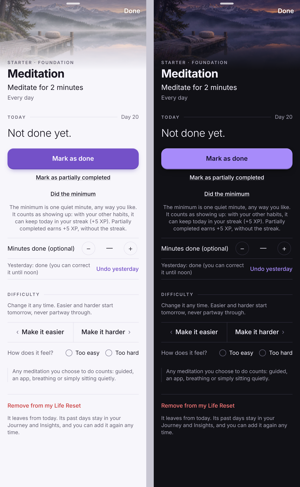 |
| 2   | Habit Details: minimum recorded (Read Daily)                                       | 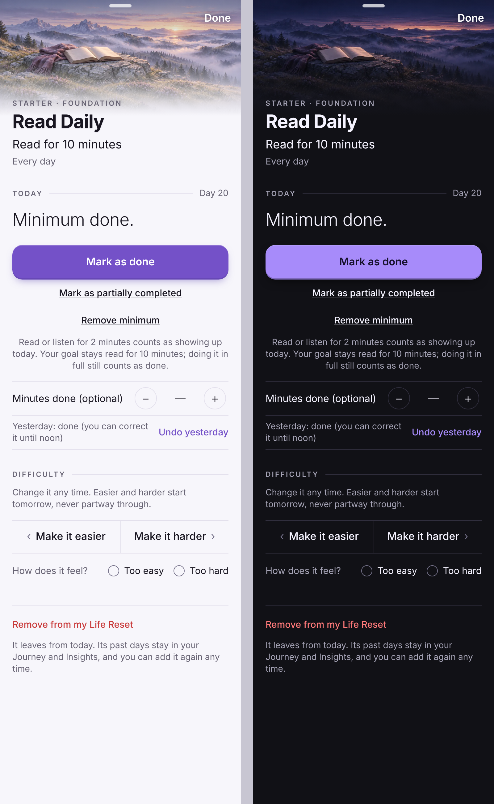  |
| 3   | Habit Details: Eat Well at Standard                                                | 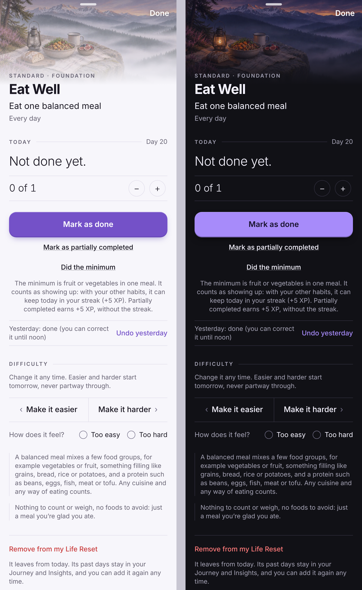          |
| 4   | Habit Details: Stay Connected at Challenge, with its safety note                   | 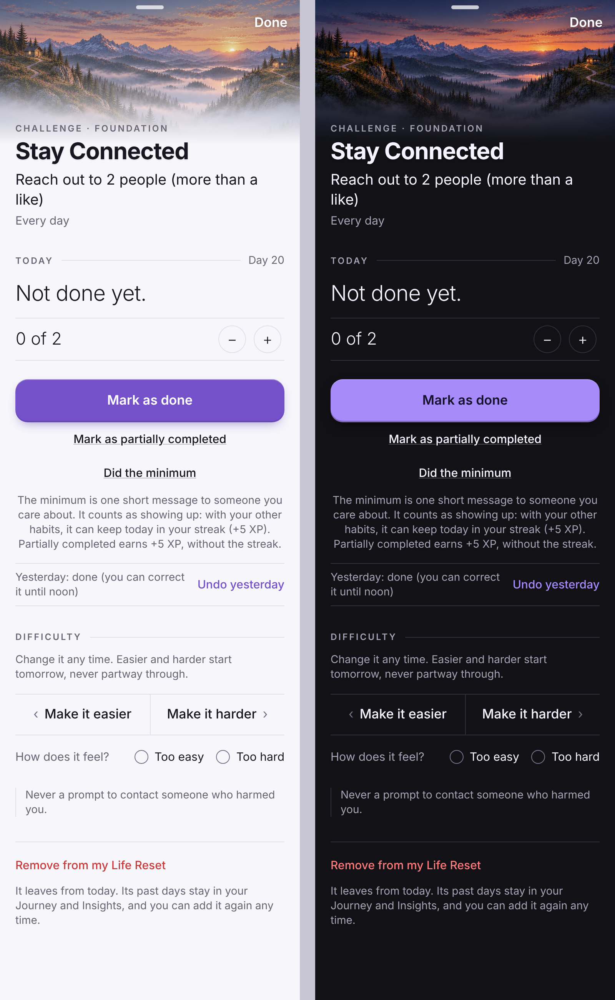    |
| 5   | Habits: "Minimum done" on Read Daily only; nothing on the others                   | 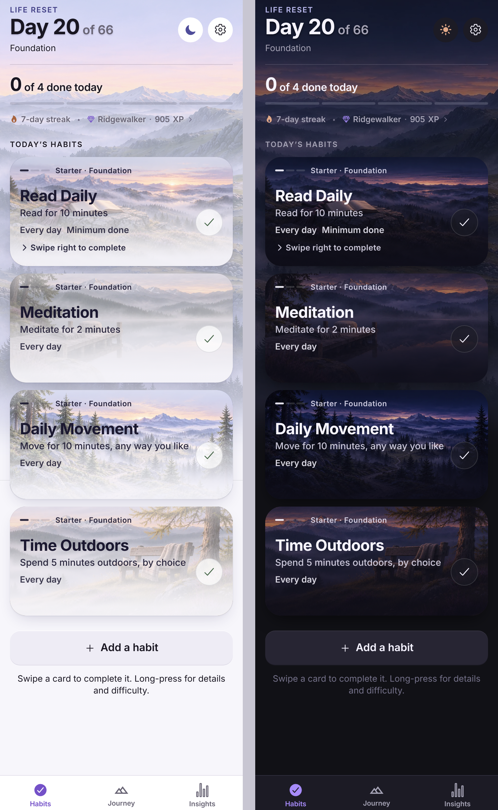   |
| 6   | Journey: the kept-day mark, with Day 13 selected                                   | 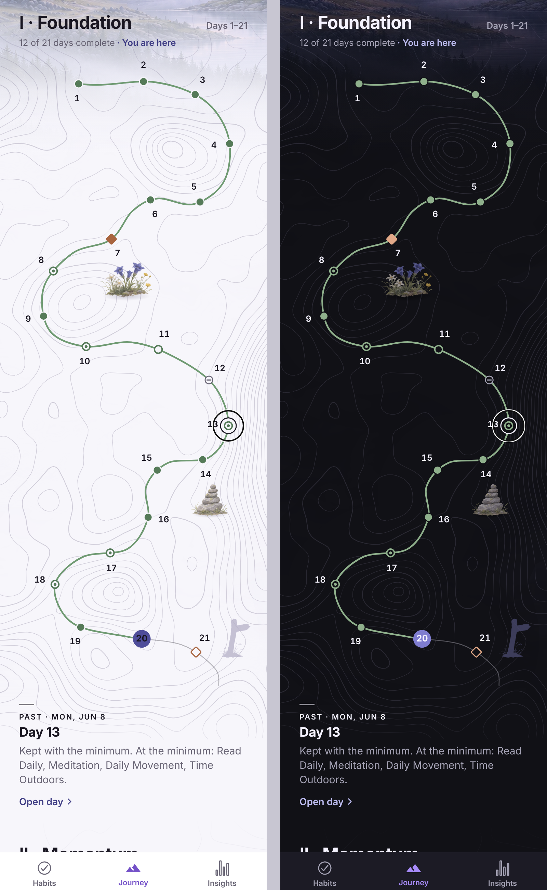          |
| 7   | Journey mark options, close up, in light and dark                                  | 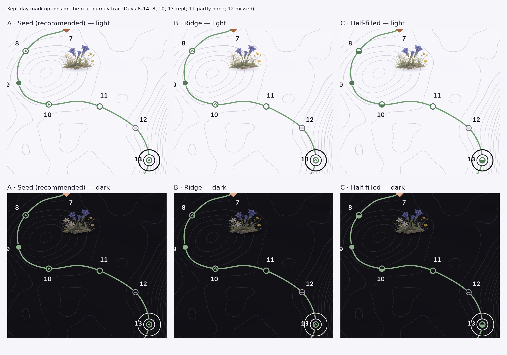      |
| 8   | Insights: consistency, with minimums named                                         | 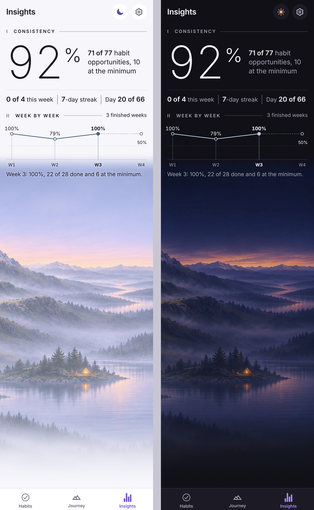      |
| 9   | Insights: habit rows (a solid line for completions, a dotted one for minimums)     | 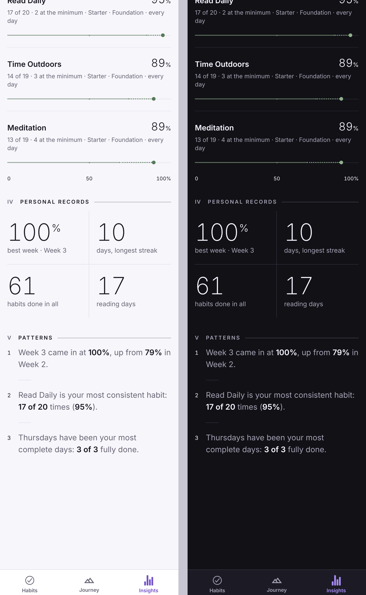       |
| 10  | After Day 66 (Keep My Momentum, Day 85): kept days as ringed dots, and the caption | 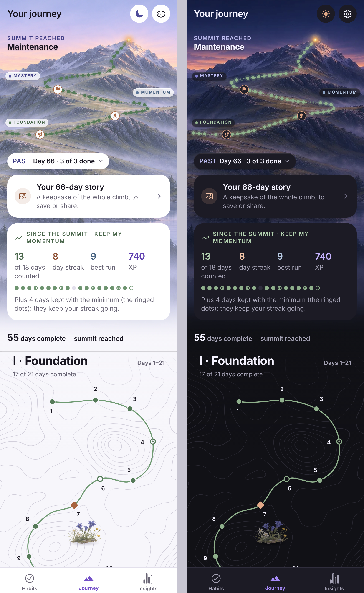                  |
| 11  | Small screen (375 pt, light): Details, Habits, Journey, Insights                   | 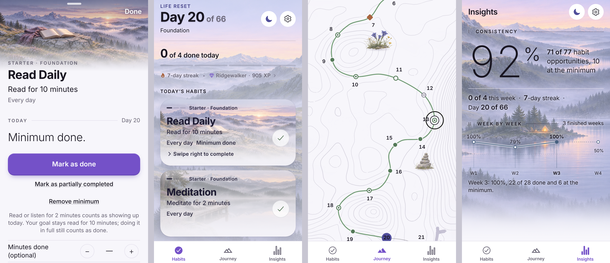              |

### What each mockup keeps and changes

- **Habit Details.**
  - **Kept:** the "Today" section's layout, the order of its actions, the `REVEAL`/`CONCEAL` crossfade, the primary
    "Mark as done", and "Mark as partially completed".
  - **Added:** the minimum is one more quiet text link in the same style, directly beneath. The existing hint line
    explains it. Nothing new appears when no minimum is available, which the Strength, Sleep and weekly-habit screens
    show.
  - **Why the short label:** "Did the minimum · {wording}" wrapped and pulled the link off-centre at iPhone width, so
    the label stays short and the wording lives in the hint.
- **Habits card.** It uses the existing secondary line (where "Partially completed" appears), only after use. The
  swipe, the done look and the artwork don't change, and the day header ("0 of 4 done today") stays honest:
  a minimum isn't done.
- **Journey.** The trail, contours, discoveries and selection ring are unchanged. A kept day is the partly-done ring
  with a small solid sage centre (§3). The selected day's entry names what was done and what was at the minimum.
- **Insights.**
  - **The headline figure** is consistency, which counts minimums. Its line says so: "71 of 77 habit opportunities,
    10 at the minimum". Without minimums the line is exactly today's.
  - **Week by week:** "Week 3: 100%, 22 of 28 done and 6 at the minimum."
  - **Habit rows:** "17 of 20 · 2 at the minimum". The bar is solid sage for completions, continues dotted for
    minimums, and ends at the consistency mark.
- **After Day 66.** The strip draws kept days as ringed sage dots, not as misses. One caption line, shown only with
  kept days, explains them. The four figures are unchanged.

---

## 3. The kept-day mark

There are three options on the real trail, in sheet 7. All of them keep the partly-done sage ring, so a kept day
still reads as "not the full plan".

| Option                     | Look                               | Assessment                                                                                                                                                                                                         |
| -------------------------- | ---------------------------------- | ------------------------------------------------------------------------------------------------------------------------------------------------------------------------------------------------------------------ |
| **A · Seed** (recommended) | The ring with a small solid centre | It reads as "between partly done and full". It's quiet at trail scale, symmetrical (so fine in right-to-left), and distinct from every existing mark in shape as well as colour. It also matches the after-66 dot. |
| B · Ridge                  | The ring with a small peak inside  | It ties to the reflection's mountain language, but at 6 pt it reads as an "up" chevron, which suggests progress or a step-up. It's also the busiest at small size.                                                 |
| C · Half-filled            | The lower half filled              | It's easiest to see, but at small size it's close to the missed mark (a horizontal bar) and to a half-done meaning. It isn't recommended.                                                                          |

**Contrast:**

- light-mode sage on the page is **4.5:1**, and on cards **4.9:1**;
- dark-mode sage on the page is **7.9:1**, and on cards **7.1:1**;
- all are above the 3:1 needed for graphics.

The mark never depends on colour alone: it's a shape inside the ring, and VoiceOver says "Kept with the minimum."

**Already in the app:** the selected day's number sits under the selection ring ("13" in the mockups). That's the
existing design and out of scope here.

---

## 4. Issues found, and proposed fixes (engine unchanged until approved)

| #   | Issue                                                                                                                                                                                                                                                                                                                                                                                         | Proposed fix                                                                                                                                                                                                                                                                                                                                                                                                                                                                                                                                                                                                         | Phase          |
| --- | --------------------------------------------------------------------------------------------------------------------------------------------------------------------------------------------------------------------------------------------------------------------------------------------------------------------------------------------------------------------------------------------- | -------------------------------------------------------------------------------------------------------------------------------------------------------------------------------------------------------------------------------------------------------------------------------------------------------------------------------------------------------------------------------------------------------------------------------------------------------------------------------------------------------------------------------------------------------------------------------------------------------------------- | -------------- |
| 1   | **After Day 66, kept days appear missed.** The Since the Summit strip reads `dayResult`, so a kept day is a grey "missed" dot. The panel's "counted" figure, and Recent Insights' "{counted} of {judged}", leave kept days out of the numerator but in the denominator, so they look like misses.                                                                                             | The strip reads `dayOutcome` and draws kept days as ringed dots (mockup 10). Keep "counted" as completed days and add the caption "Plus {n} days kept with the minimum…" when n > 0. Recent Insights adds "{kept} kept with the minimum" in the same way. VoiceOver labels (`beyond.since.a11y`, `beyond.recent.a11y`) gain the kept count.                                                                                                                                                                                                                                                                          | R2b (UI)       |
| 2   | **An older app shows a shorter streak for archived journeys.** Past journeys live in their own store (`schwung-journeys`, version 1), which wasn't bumped with the program save. An older build would recompute an archived journey without kept days. It wouldn't lose data, but it would show a smaller best streak.                                                                        | Bump `JOURNEYS_VERSION` 1 → 2 with an identity migration, in the same change that first lets a minimum be recorded. The store already holds a newer-version journeys store for recovery instead of reading it, so an older build keeps it untouched. Backups are already protected: their `saveVersion` is 3. Tests: v1 loads unchanged; v2 is held by a v1 reader.                                                                                                                                                                                                                                                  | R2b, engine    |
| 3   | **Edited backups.** Counting trusts a saved minimum on any daily habit in the program, so an edited backup could mark a day kept with a minimum Schwung never offered (Sleep, Less Scrolling, a custom habit, Eat Well at Starter).                                                                                                                                                           | Add an **append-only record of minimums that have ever been offered**, by habit and level, in `minimum.ts`. Once a minimum ships it's never removed from the record, even if it's later withdrawn. `minimumOn` then also requires the habit and that day's level to be on it, and never a custom habit. So recorded days never change, and impossible ones never count. A restore keeps the raw record untouched (no data loss) and simply doesn't count such flags. Tests: a forged Sleep, Less Scrolling, custom or Starter Eat Well minimum is ignored; one recorded before a minimum was withdrawn still counts. | Engine         |
| 4   | **Insights' numbers disagree once minimums exist** (found while mocking up). In R2a's engine, the "most consistent habit" observation says "17 of 20 times (95%)": the percentage counts minimums but the count doesn't. The weekly trend's percentage counts minimums while its words say "22 of 28 done". The Insights screen's own headline and habit rows still compute completions only. | One rule: wherever a percentage includes minimums, the words say so ("{done} of {eligible} and {minimum} at the minimum", mockups 8–9). The observation gets a variant with minimums, and the screen uses `P.consistency`. This only shows with a minimum recorded, which no one can do yet.                                                                                                                                                                                                                                                                                                                         | Engine and R2b |
| 5   | The Habits header says "0 of 4 done today" on a day with a minimum.                                                                                                                                                                                                                                                                                                                           | **Keep it.** It's honest (a minimum isn't done), and the card already says "Minimum done". Listed here only so the choice is explicit.                                                                                                                                                                                                                                                                                                                                                                                                                                                                               | —              |

---

## 5. Light and dark, small screens, accessibility

- **Light and dark:** every mockup is shown in both themes. The marks, dotted line and links use the existing tokens
  (`sage`, `textDim`, `indigoInk`), so no new colour is introduced.
- **Small screens (375 pt):** nothing new truncates. The hint wraps to three lines, the link label is a single short
  line, and the Insights headline line wraps to three lines next to the figure. The existing "Minutes done (optional)"
  row already wraps on small screens; that isn't new.
- **Dynamic Type** isn't reproducible in the web build. Planned checks on device:
  - the hint is body text and wraps;
  - the link follows `TextLink`'s existing large-text behaviour;
  - the Insights line keeps `maxFontSizeMultiplier={1.5}`;
  - the Journey mark doesn't scale with text, just as today.
- **VoiceOver:**
  - the action reads "Did the minimum, button", with the hint as the next element;
  - the state line is a polite live region, as now;
  - the card summary adds "Minimum done";
  - a Journey day reads "Day 13. Kept with the minimum.";
  - Insights labels include the minimum count, after fix 4.
- **Motion and haptics:** the existing crossfades are used, and they follow Reduce Motion. Recording a minimum uses
  `haptic.select`, never the completion haptic or celebration.
- **Right to left:** the seed mark is symmetrical. The dotted segment follows the bar's existing `physical` direction
  handling. Arabic and Urdu still need a check on device.

---

## 6. Decisions requested

1. Approve, change or reject each minimum in §1.2: wording, levels and the reviewer's sign-off.
2. Approve the shared wording in §1.1, including "can keep today in your streak".
3. Choose the Journey mark: **A Seed** (recommended), B Ridge or C Half-filled.
4. Approve the screen placements in §2 (Details, card, Journey entry, Insights wording, after-66 strip).
5. Approve fixes 1–4 in §4, and confirm 5 stays as it is.
6. Then R2b: build the screens and fixes, add translations through the i18n workflow, take device screenshots, and
   enable each minimum only once it's individually approved.

**Limitations of this package:**

- It's a web build in Chromium, not an iPhone, so there are no haptics, no Dynamic Type and no real VoiceOver.
- It shows English only.
- Seeded data isn't real use.
