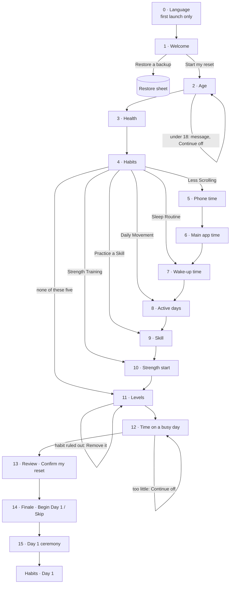

# Onboarding design audit

Baseline `57c8999`, 8 November 2026. Audit and screenshots only: no production code was changed.

## How this was tested (read first)

- **Web build only.** Every screenshot comes from the QA web export (`npm run qa:build`) in Chromium, driven by a script from a cleared browser (no saved data: a fresh install). **No iPhone, simulator or Android device was used**; nothing here is a native result.
- 390 × 844 pt at 2×, unless marked. Reduced motion was on, so transitions and the finale's animations show their resting frames; motion is not assessed.
- **Arabic RTL** is emulated by setting `dir="rtl"` on the page with the Arabic catalog. The web build itself is always left-to-right, so start/end alignment and mirrored icons may differ on a device.
- **Larger text** is approximated by a script that enlarges every text element to 130 %. The web build always reports a text scale of 1; native `maxFontSizeMultiplier` caps and Dynamic Type line-breaking are not reproduced.
- The screen sequence was read from the code and confirmed in the live build (flow map below).

## Deliverables

All in `docs/design-exploration/onboarding-audit/`:

| What | File |
|---|---|
| Flow map | `flow-map.png` (and the Mermaid version below) |
| Full journey, light | `sheet-1-light-journey.jpg` · frames in `1-light/` |
| Full journey, dark | `sheet-2-dark-journey.jpg` · `2-dark/` |
| Interaction states | `sheet-3-interaction-states.jpg` · `3-states/` |
| Conditional branches | `sheet-4-conditional-branches.jpg` · `4-branches/` |
| 320 pt, German, Arabic, larger text | `sheet-5-checks-{w320,de,ar,big}.jpg` · `5-checks/` |

Frames are full resolution (780 × 1688 px, JPEG). Names carry the step order: `L14-habits` is light frame 14; `-scrollN` frames are the same screen scrolled. The journey takes the path that shows every screen type (Suggest three, plus Less Scrolling, Practice a Skill and Strength Training).

## The flow

(The life questions appear only for chosen habits, always in this order; a skipped one is passed straight through.)

**What changes the path, and what doesn't**

| Answer | Effect | Seen in |
|---|---|---|
| Age under 18 (12–17) | Red line "Schwung is made for people 18 and older", Continue disabled. No other screen. | `S-age-01`, `S-age-02` |
| Age 18–64 | Nothing visible; only the band is kept. | `S-age-03` |
| Age 65+ | An extra note on the Strength question. | `B7` |
| Health: joint pain | Strength's Starter level unavailable; an extra note on Strength. | `B4` |
| Health: walking difficulty, heart, pregnancy | Daily Movement and Strength tiles unavailable on Habits. | `B3` |
| Health: "Rather not say" | Strength unavailable ("answer the health question first"). | `B2` |
| Health: fluid limit, sleep condition | **No effect anywhere** in the engine: asked, then unused. | — |
| Habits chosen | Decide which of screens 5–10 appear (none for Eat Well, Get It Done, Read Daily, Meditation, Time Outdoors, Stay Connected). | `B1` (Read Daily only: Habits → Levels) |
| Phone under 2 h | Less Scrolling ruled out: on Levels it shows "Not available … Remove it" and blocks Continue. | `B5` |
| Wake "varies a lot" / "shifts" | Sleep Routine ruled out the same way. | `B6` |
| Active days, strength start, main-app time | Change the suggested level on Levels (e.g. 5+ days → Movement at Challenge). | `S-life-14` |
| Strength at Challenge | Adds "Sessions a week you already do" (2–7). | `S-life-16` |
| Busy-day time below what habits need | Red message, Continue disabled. | `L36`, `S-life-20` |

**Screen count before the plan.** Shortest path (one habit with no life question): Language, Welcome, then 6 set-up screens (Age, Health, Habits, Levels, Time, Review). Longest (all five question-asking habits): 12 set-up screens. Habits are chosen at set-up screen 3, which is early and good.

**Not reachable from a fresh install:** the age-limit screen (`/age-limit`: only for programs begun under 18 before the minimum became 18), custom habits (added later from Habits; so long custom names can't appear in onboarding), the teen level rules (under-18s can't start), and "maximum habits" (the limit is 30; only 11 exist, so "all eleven" is the real maximum: `S-habits-07`).

## Overall verdict

The two ends of onboarding already feel like Schwung: the welcome painting and the finale's trail over the mountain are the strongest screens in the app's first minutes. **The middle doesn't.** From Age to Review the screens are a toolkit of individually clever instruments (a ruler, a phone that fills up, a sky with a sun, a flat green mountain, growing bars, icon tiles, a dial), each in its own visual language, on backgrounds that change tint every chapter. Nothing there uses the field-journal grammar the redesigned app now speaks (small-caps headings on hairlines, ledger rows, peach-rule notes, quiet underlined links, painted art), so the hand-off at "Begin Day 1" is a jump from a playful quiz into a calm journal.

Three themes run through the screen notes:

1. **Too many visual languages.** Flat-vector illustrations (phone, sky, mountain trail, stairs, skill icons) sit between painterly art at both ends. Chapter colour washes (lavender, peach, mist, sage, indigo) make the same page look different every few screens.
2. **Pills and tinted tiles everywhere.** Health chips, None/Rather-not pills, Suggest three, Not sure, varies/shifts, level tiles, review chips and level badges. That is exactly the "cards, pills and icon tiles" vocabulary the main app removed.
3. **Coloured choices that imply judgement.** Levels paint Starter sage, Standard indigo and Challenge peach. Strength's bars grow taller. Age under 18 is in error red. The weekly reflection was just made neutral for this reason; onboarding hasn't caught up.

Pacing is reasonable in length but flat in feeling: the payoff (your habits, your mountain) only arrives at Review, and the arrival is then told **three times** (Review, "Day 1 starts today", "The climb starts here") before the person reaches their habits.

## Screen by screen

Scores: 1 = needs rethinking, 3 = serviceable but off-style, 5 = at the main app's standard.

### 0 · Language (`L01`–`L05`)
- **Purpose:** choose the app language on first launch (the device language is pre-highlighted).
- **Visual quality: 2/5.**
- **Main weakness:** a drum picker inside a rounded, outlined card, with every language name also printed sideways around the frame's edges and along the bottom. It is decorative noise on the very first screen, and the far-off rows fade to near-illegible grey.
- **Interaction:** the wheel is fiddly with 20 entries. Selection only shows by a faint highlight band; the "selected" frame (`L05`) is indistinguishable from the initial one. Native-script names are the right call.
- **Direction:** a calm list of languages as journal rows (name in its own script, a check for the chosen one) under the Schwung wordmark, on the page colour or a shallow painting strip. No frame, no rotated text.
- **Priority: High** (it is the first impression).

### 1 · Welcome (`L09`)
- **Purpose:** the promise and the start: "66 days to build better habits", Start my reset, Restore a backup.
- **Visual quality: 4/5.**
- **Main weakness:** the painting is strong, but small white map-pin icons dotted on the slopes look like a generic map UI. "Free. No account. No paywall." reads like a pricing page, louder than the promise.
- **Interaction / layout:** **defect:** at 320 pt (`w320-01`) and with larger text (`big-01`), the subtitle is drawn on top of the headline. In German the headline needs three lines and still fits (`de-01`).
- **Direction:** keep the composition; let the trail itself carry the journey instead of pins; set the reassurance as a quiet line; fix the overlap.
- **Priority: Medium** (the overlap: **High**).

### 2 · Age (`L10`, `L11`, `S-age-01…05`)
See the dedicated section below.
- **Visual quality: 2/5.**
- **Main weakness:** a generic ruler plus −/+ buttons around an empty disc and a dash.
- **Interaction:** three ways to set one number. 18+ is only explained after a wrong answer, in error red.
- **Direction:** see below.
- **Priority: Critical.**

### 3 · Health precautions (`L12`, `L13`, `S-health-01…03`)
- **Purpose:** safety-relevant conditions that rule out or limit Movement and Strength.
- **Visual quality: 3/5.**
- **Main weakness:** six white rounded chips with peach icon circles, then two half-width pills ("None of these", "Rather not say") that wrap onto two lines each. Selected chips turn peach, "None" turns sage and "Rather not say" turns slate: three colour meanings on one sensitive question.
- **Interaction / why asked:**
  - The hint ("We'll keep every habit safe for you. It never leaves your phone.") is good.
  - It's the second question, before the person has seen any value, which is a heavy ask early.
  - Two of the six answers (fluid limit, sleep condition) currently change nothing, which undermines the "why".
  - At 320 pt the two exit options fall below the fold (`w320-08`).
- **Direction:**
  - Use a journal checklist: hairline rows with a quiet check, and "None of these" / "Rather not say" as rows of equal standing below a divider.
  - Consider asking it after Habits, where the reason is concrete. That would be an order change, so it needs a product decision.
  - Flag the two unused precautions for a product/safety review. **Don't change rules here.**
- **Priority: High.**

### 4 · Habits (`L14`–`L19`, `S-habits-*`, `B2`, `B3`)
- **Purpose:** choose habits from 11 painted tiles, with an optional "Suggest three".
- **Visual quality: 4/5.**
- **Main weakness:** the paintings are the best material in onboarding, but the grid is long (three screenfuls), the tiles are heavy rounded cards with outlines and checks, and the "SUGGESTED" badges read as advertising.
- **Interaction:**
  - The count is shown only as tiny dots ("Stones") and is easy to miss.
  - Unavailable tiles fade and their reason is set in tiny text on the faded art, nearly unreadable (`B2-…`, `B3-…`), and tapping one only gives a haptic warning (no visible response on web).
  - "Two to four is a good start" is helpful.
- **Direction:**
  - Keep the paintings, lighter: a calmer two-column grid without outlines, the selection as a fine accent edge and check, and "Suggested" as a quiet caption.
  - Explain an unavailable habit in a readable line, not on the art.
  - Show "3 chosen" in words.
- **Priority: Medium.**

### 5 · Phone time and 6 · Main app time (`L20`–`L23`, `S-life-01…05`)
- **Purpose:** baselines for Less Scrolling; under 2 h rules the habit out.
- **Visual quality: 3/5.**
- **Main weakness:** a flat cartoon phone that fills with peach liquid and sprouts notification dots, a toy-like illustration in a new style. The two questions are near-identical screens back to back.
- **Interaction:**
  - Drag on the phone, tap the scale, or tap a label: generous.
  - "Under 1 h" overflows the phone (`S-life-01`).
  - At 320 pt the title scrolls under the progress bar and "Not sure" needs a scroll (`w320-17/18`).
  - Answering "under 2 h" doesn't say Less Scrolling will be ruled out; the person finds out two screens later on Levels.
- **Direction:**
  - Merge into one page with two journal scales (hairline rows of hours), or keep two questions with one consistent instrument.
  - Say the consequence where it's caused.
- **Priority: Medium.**

### 7 · Wake-up time (`L24`, `L25`, `S-life-06…09`)
- **Purpose:** the anchor for Sleep Routine.
- **Visual quality: 3/5.**
- **Main weakness:** a flat sky card with a sun/moon and green hills (another vector style) above the same ruler as Age, plus two pill buttons. The time and its caption ("A morning person") are nice.
- **Interaction:** the ruler, ±15 min and the pills form three controls. "It varies a lot" / "I work shifts" quietly rule out Sleep Routine without saying so (`B6`).
- **Direction:** a clean time readout with ± and a simple list of common times, the painting's own light for morning/evening, and the varies/shifts options as rows with their consequence stated.
- **Priority: Medium.**

### 8 · Active days (`L26`, `L27`, `S-life-10…11`)
- **Purpose:** baseline for Daily Movement.
- **Visual quality: 3/5.**
- **Main weakness:** the trail up a mountain is the right metaphor, and the hiker walking to the milestone is charming. But it's a flat green vector mountain, not Schwung's painting, and labels like "Base camp" sit in small grey type on the slope.
- **Interaction:** clear and quick; the four choices are well spaced.
- **Direction:** keep the idea, draw it in the journal hand (a hairline trail over the existing painting or a contour sketch), with labels as readable rows.
- **Priority: Medium.**

### 9 · Skill (`L28`, `L29`)
- **Purpose:** which skill to practise.
- **Visual quality: 2/5.**
- **Main weakness:** seven lavender icon circles in a grid: the most generic screen in the flow, and no hint (it's the only question without one).
- **Interaction:** fine, but small targets with labels underneath and lots of empty space.
- **Direction:** a simple list of journal rows (skill name, a short example), with a hint.
- **Priority: Medium.**

### 10 · Strength start (`L30`, `L31`, `S-life-12…13`, `B4`, `B7`)
- **Purpose:** starting point for Strength Training, with safety guidance.
- **Visual quality: 3/5.**
- **Main weakness:** three abstract green bars of growing height read as a bar chart and imply "more is better".
- **Interaction / safety:**
  - The three safety paragraphs (what Schwung tracks, get a qualified routine, stop if chest pain) are set in faint small grey at the bottom, the least prominent text on the screen, though they matter most.
  - "Sometimes" breaks mid-word at 320 pt and with larger text ("Sometime-s", `w320-21`, `big-15`).
- **Direction:**
  - Three neutral rows (New to it / Sometimes / Regularly) with their descriptions.
  - Safety guidance as a peach-rule note in readable body text. The wording stays exactly as is.
- **Priority: Medium** (safety text prominence: **High**).

### 11 · Levels (`L32`–`L34`, `S-life-14…19`, `B4`, `B5`, `B6`)
- **Purpose:** choose Starter / Standard / Challenge per habit, with a suggestion pre-selected.
- **Visual quality: 3/5.**
- **Main weakness:** a white card per habit holding three mountain-icon tiles; the selected tile is filled in sage, indigo or peach depending on the level. That is a colour code implying value, and inconsistent with the new neutral weekly-reflection rows. With six habits it's three screens of near-identical cards.
- **Interaction:**
  - Why a level is pre-selected is never said. The suggestion silently follows earlier answers.
  - A ruled-out habit appears here in red with "Remove it" and blocks Continue (`B5`, `B6`). That's the right safeguard, but it surprises the person far from its cause.
  - German "Heraus-forderung" hyphenates inside the tile (`de-14`).
- **Direction:**
  - One ledger row per habit: name, today's target in words, and a compact three-way divided control with one accent (like the Settings appearance control).
  - Mark the suggested level as "suggested" in words.
- **Priority: High.**

### 12 · Time on a busy day (`L35`–`L37`, `S-life-20…22`)
- **Purpose:** check the chosen habits fit a full day.
- **Visual quality: 3/5.**
- **Main weakness:** a thick donut dial in peach/sage with a small "Your habits need about 70 min" pill below. The red warning paragraph under it is the loudest thing on the screen.
- **Interaction / layout:**
  - Clear feedback, "A little short" / "Your habits fit", a good touch.
  - **Defect:** at 320 pt the warning runs under the footer (`w320-27`).
  - The red message tells people to "choose an easier intensity or fewer habits", but those are back two screens.
- **Direction:** a quieter instrument (thin ring or a single scale), the need stated as a plain sentence, the shortfall as a peach-rule note with a link back to Levels.
- **Priority: Medium.**

### 13 · Review: "Here's your reset" (`L38`, `L39`, `S-life-23`, `B1-06`)
- **Purpose:** the plan before confirming. It's the emotional peak of set-up.
- **Visual quality: 3/5.**
- **Main weakness:**
  - A fan of the habit paintings (nice) followed by three coloured pills ("6 habits", "66 days", "From today").
  - Then rows each with a coloured level badge in rotating tints (lavender, peach, sage, mist, indigo, unrelated to the level).
  - The fine print is in grey caption.
  - It looks like a summary card, not the first page of an expedition.
- **Interaction / layout:** "Confirm my reset" wraps to two lines at 320 pt and in German (`w320-29`, `de-18`). With six habits the list scrolls and the total sits at the very end.
- **Direction:**
  - "Your expedition" as a journal page: the fan or the mountain, a small-caps line "66 days · 6 habits · from today", ledger rows with level in plain text, the time fit as a single sentence, then one confident action.
  - Fold the finale's mountain into it (see Top 5 #3).
- **Priority: High.**

### 14 · Finale: "Day 1 starts today" (`L40`, `B9`)
- **Purpose:** the reveal: the trail drawn over the mountain, the habit stones, "Begin Day 1".
- **Visual quality: 4/5.**
- **Main weakness:** beautiful, but it immediately precedes a second, near-identical moment. In Arabic the painting appears offset, leaving a dark strip at one edge (`ar-21`; possibly an artefact of the RTL emulation; check on device).
- **Interaction:** Skip is available; good.
- **Direction:** keep as the single arrival moment, merged with the ceremony (below).
- **Priority: Medium.**

### 15 · Day 1 ceremony: "The climb starts here" (`L42`)
- **Purpose:** the first ceremony on Habits.
- **Visual quality: 4/5.**
- **Main weakness:** a second full-screen painting with a headline and a button, seconds after the finale, saying the same thing. It's well made, but the repetition dulls both.
- **Direction:** one moment, not two. Either the finale hands straight to Habits, or the ceremony becomes the finale's last beat. **The ceremony is shared logic, so this needs a product decision.**
- **Priority: Medium.**

### Restore from backup (`B8`)
- **Purpose:** bring a backup in, from Welcome.
- **Visual quality: 3/5.**
- **Main weakness:** a plain sheet; fine, but generic next to Settings' journal style.
- **Direction:** align with Settings later.
- **Priority: Low.**

### Shared chrome: progress, chapter label, footer (all set-up screens)
- **Visual quality: 3/5.**
- **Main weakness:**
  - A dotted trail progress line with a small coloured chapter name at the top right ("You", "Your habits"…).
  - Full-screen tinted washes that change per chapter.
  - A round white back button beside a big violet Continue.
  - The progress trail is a good idea, but too faint to read, and the chapter names are tiny and pushed to the edge.
- **Interaction:** Continue is disabled until answered, which is correct, but the disabled violet is close to the enabled one on light backgrounds. The footer stays put at 320 pt, which is good.
- **Direction:** one page colour throughout, a clearer trail with the chapter in small caps on the left, and the same footer as the New Ascent sheet.
- **Priority: High** (it touches every screen).

## The age screen in depth

**Why the interaction feels weak**

1. *Three controls for one number.* A big readout, − and + buttons and a sliding ruler all set the same value, so none of them feels like the control. The ruler is the kind found in fitness apps for weight or height; it brings measuring-tape connotations, not a journey.
2. *An empty start.* Before touching anything there is a faint disc, a grey dash and "Slide the ruler to your age". The first thing a new person meets is an instruction for a widget.
3. *Precision nobody needs.* Only the band is kept (18–29, 30–49, 50–64, 65+), yet the person must dial an exact age, one year per tap: about 45 taps from the start to reach 70. The band then appears as a small lavender caption, which is the only thing the app actually uses.
4. *Edge states look broken.* At 90+ the ruler goes blank because it scrolls past its marks (`S-age-05`). At 12 the − disappears without explanation.

**Does it communicate the age requirement?**

No. Nothing says "18 or older" until someone picks an age under 18. Then "Schwung is made for people 18 and older" appears in error red under the number, and Continue turns off with no next step (`S-age-01/02`). For a 16-year-old that's a dead end that feels like a mistake rather than a policy. The hint "So every habit fits you" doesn't mention the requirement either.

**Would a simpler interaction be more elegant?**

Yes, and it would match what's stored.

- **Option A (bands as rows):** five journal rows: *Under 18*, *18–29*, *30–49*, *50–64*, *65 or older*. One tap, no dial. "Under 18" leads to a calm, explained screen (who Schwung is for, nothing saved) instead of a red line. It is the simplest and most honest option, with no new logic: the bands already exist.
- **Option B (a confirmation, then a band):** "Schwung is for adults. Are you 18 or older?" Then the band rows. The requirement is stated before anything is asked.
- **Option C (keep exact age, simpler control):** one large number with − / + (and the system number pad on tap). Drop the ruler, start empty, and state "18 or older" in the hint.

All three keep the age-eligibility rule exactly as is. A and B change the interaction; C is mostly visual.

**Using the mountain without gimmick**

The program's mountain could carry the bands as **altitude marks on a contour line**: a thin hairline ridge with five labelled waypoints, the chosen one marked as a waypoint is on the Journey trail.

- Done quietly, in the Journey's own drawing style, it ties the first question to the 66-day climb.
- What to avoid: a hiker character, a slider that "climbs" with the age, or framing older ages as "higher". Age isn't progress, and the metaphor shouldn't rank people.

My recommendation is Option A with the contour treatment kept very light.

## Pacing and emotional experience

- **Anticipation:** Welcome promises "66 days"; then six to twelve questions follow, under small chapter labels, before the mountain returns. The chapters ("You", "Your habits", "Your life", "Your start", "Your reset") are a good story shape, but they're nearly invisible (a tiny label top-right), so the story isn't felt.
- **Questions before habits:** only Age and Health come first, which is right. The long part comes *after* choosing habits (up to six life questions, Levels, Time). It's justified, since each question serves a chosen habit. But the screens don't say so beyond a small habit-name eyebrow ("LESS SCROLLING"). Saying "For Less Scrolling" plainly would make every question feel earned.
- **Is choosing habits personal?** The paintings make it so. What weakens it: the "SUGGESTED" badges and the one-tap "Suggest three" both nudge toward a default set, and the chosen habits are never reflected back until Review.
- **Does the plan feel like an adventure's start?** Not at Review (a summary with pills). It does at the finale, which is then immediately repeated by the Day 1 ceremony. One strong arrival would land better than three soft ones.

## Layout defects found (web build)

These are defects, not taste. All are in the screenshots; none were fixed.

| # | Where | What | Frames |
|---|---|---|---|
| 1 | Welcome, 320 pt and larger text | Subtitle overlaps the headline | `w320-01`, `big-01` |
| 2 | Time, 320 pt | The shortfall message runs under the footer | `w320-27` |
| 3 | Strength, 320 pt and larger text | "Sometimes" breaks mid-word | `w320-21`, `big-15` |
| 4 | Review, 320 pt and German | "Confirm my reset" wraps to two lines | `w320-29`, `de-18` |
| 5 | Age at 90+ | The ruler shows no marks | `S-age-05` |
| 6 | Phone time "Under 1 h" | Readout overflows the phone drawing | `S-life-01` |
| 7 | Levels, German | "Heraus-forderung" hyphenates inside the level tile | `de-14` |
| 8 | Finale, Arabic (emulated) | Painting offset, dark strip at one edge (verify on device) | `ar-21` |
| 9 | Language | Initial and selected frames look identical | `L01`, `L05` |

Dark mode shows no defects beyond those above; contrast of faint captions on the dark painting (Welcome's subtitle, Strength's safety text) is the weakest point there.

## Top five redesign opportunities

1. **One journal question template for every set-up screen.**
   - What: replace the chapter colour washes, chip/pill/tile vocabulary and floating instruments with the main app's grammar: one page colour (a shallow painting strip at the top, as in Settings), small-caps chapter heading on a hairline, the question, its "why" in a sentence, answers as hairline rows with one accent, notes with a peach rule, and quiet links.
   - *Gain:* onboarding finally looks like the app it leads into. Every later screen redesign becomes small, and 320 pt / German / larger text get easier (rows wrap gracefully).
   - *Type:* mostly **visual**, applied screen by screen. It reuses existing copy and logic.
2. **Rethink the age screen.**
   - What: band rows (or adult confirmation then bands), with the 18+ requirement stated up front and a calm under-18 outcome.
   - *Gain:* the weakest first impression is removed, the eligibility rule is honest and clear, and the data asked for matches the data kept.
   - *Type:* **interaction redesign** (rules unchanged).
3. **One arrival: Review becomes the expedition page, then a single ceremony.**
   - What: turn Review into "Your expedition" (mountain, small-caps facts, ledger rows, one action), then merge the finale and the Day 1 ceremony into one moment that hands over to Habits.
   - *Gain:* the end of onboarding feels like setting out, not three confirmations.
   - *Type:* visual for Review. **Interaction/flow** for merging the moments (needs a product decision on the ceremony).
4. **Neutral, explained level choice.**
   - What: Levels as one row per habit with a divided Starter / Standard / Challenge control in one accent, the suggested level labelled and explained. Ruled-out habits are flagged where they're caused (phone time, wake-up), not two screens later.
   - *Gain:* consistency with the weekly reflection, no colour judgement, fewer surprises, about half the scrolling.
   - *Type:* visual plus **light interaction** (where the consequence is shown). Logic unchanged.
5. **One illustration language, and the defects fixed.**
   - What: retire the flat-vector instruments (phone, sky card, green mountain, bars, skill icons) in favour of journal drawings (hairline scales, contour lines) over the existing paintings, and fix the nine layout defects above.
   - *Gain:* a coherent journey from Welcome to Day 1, and a flow that holds at 320 pt, in long languages and with larger text.
   - *Type:* **visual** (no new artwork: hairlines and existing paintings only).

## What this audit did not do

- No production code, logic, safety rules, recommendations, age eligibility or saved data was changed. No new artwork was made.
- No device testing. Motion, haptics, VoiceOver and real Dynamic Type remain to be checked on an iPhone.
- The two health precautions that currently have no effect are reported, not changed.
